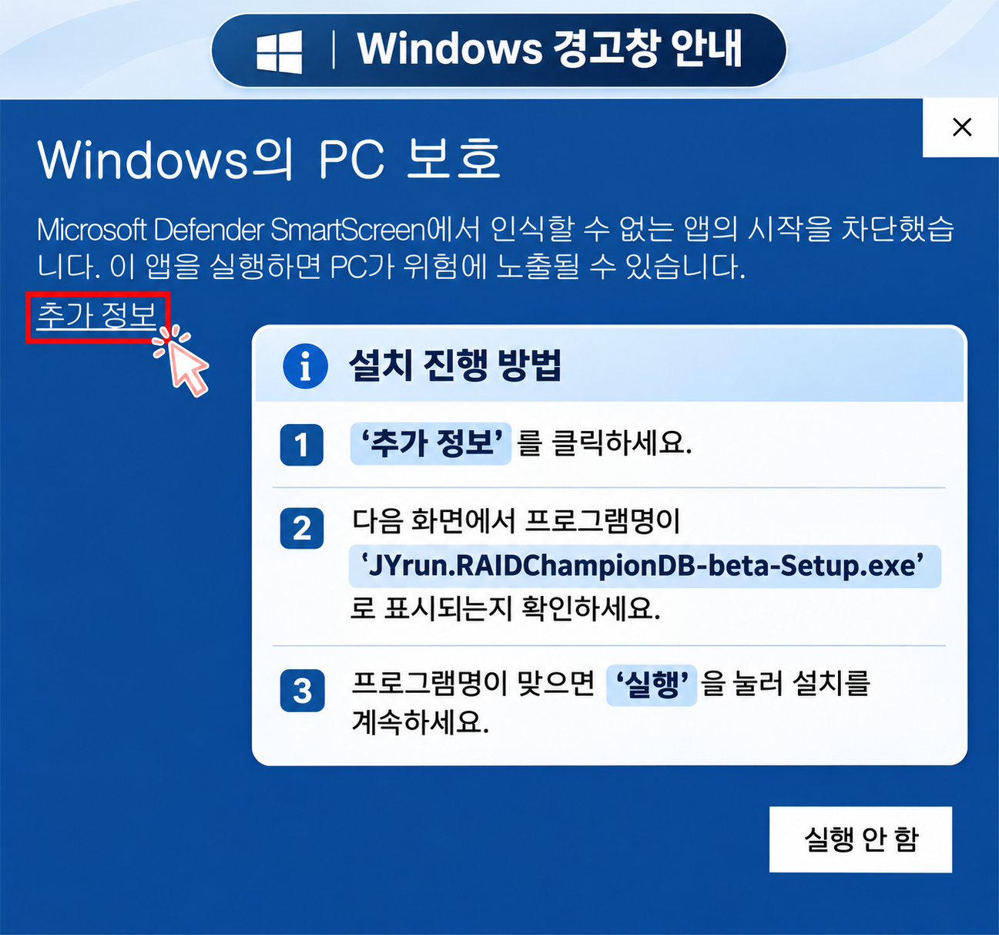

# RAID Champion DB

RAID Champion DB는 한국 RAID: Shadow Legends 유저를 위한 무료 Windows 프로그램입니다. 챔피언 검색·상세정보, 보유 챔피언 관리, 팀 구성·저장, 데몬로드 전투 분석을 제공합니다. 이번 버전은 기존 기능을 유지하면서 프로그램과 게임 데이터를 자동 업데이트하는 설치 방식을 제공합니다.

## 최신 베타버전 다운로드

**프로그램 1.0.0-beta.30.7 · Windows 10/11 64비트 · 무료**

[공식 beta.30.7 Release](https://github.com/dlckdtnr1212-lang/RAID-Champion-DB/releases/tag/v1.0.0-beta.30.7)

### 처음 설치하는 분

[JYrun.RAIDChampionDB-beta-Setup.exe](https://github.com/dlckdtnr1212-lang/RAID-Champion-DB/releases/download/v1.0.0-beta.30.7/JYrun.RAIDChampionDB-beta-Setup.exe) **하나만** 다운로드해 설치하세요. Windows 10/11 64비트를 지원하며 Python을 별도로 설치할 필요가 없습니다. Setup은 약 1.01GB입니다.

### beta.29 ZIP을 사용하던 분

보유 챔피언·팀·설정을 먼저 저장하고 개인 자료를 백업한 뒤, 모든 프로그램을 종료하고 같은 Setup을 **최초 한 번** 설치하세요. beta.29 ZIP은 자동으로 새 설치본으로 바뀌지 않습니다. 기존 ZIP 폴더를 먼저 지우거나 그 안에 덮어쓰지 마세요.

새 설치본을 열어 기존 보유 정보와 팀이 유지되는지 확인하세요. 기본 개인 데이터 위치를 사용했다면 같은 저장 파일을 계속 사용합니다. 별도 저장 위치나 ZIP 내부 자료의 자동 이전은 보장하지 않습니다. 두 버전을 동시에 실행하지 마세요.

### beta.30.6 설치를 마친 분

**Setup을 다시 다운로드할 필요가 없습니다.** 설치된 프로그램을 실행해 공개된 업데이트를 확인하세요. 새 업데이트가 있으면 앱 안내에 따라 적용하고 필요한 경우 재시작하세요. 이미 최신 버전이면 업데이트가 발생하지 않습니다.

[자세한 설치·백업 안내](https://github.com/dlckdtnr1212-lang/RAID-Champion-DB/releases/download/v1.0.0-beta.30.7/INSTALL_KO.md) · [메모장용 안내](https://github.com/dlckdtnr1212-lang/RAID-Champion-DB/releases/download/v1.0.0-beta.30.7/READ_ME_FIRST_KO.txt)

## 자동 업데이트와 데이터 버전

최초 설치 후에는 프로그램 실행 시 공개된 프로그램·게임 데이터 업데이트를 확인하고 필요한 파일을 내려받습니다. GitHub 회원가입·로그인이나 인증 토큰은 필요하지 않습니다. 업데이트 파일을 GitHub에서 직접 찾거나 데이터 ZIP을 수동으로 풀 필요도 없습니다.

작업을 저장하고 앱의 적용·종료·재실행 안내를 따라 주세요. 프로그램 파일은 앱이 안전하게 닫힌 뒤 교체되며, 게임 데이터는 재시작 후 화면에 반영됩니다. 설정이나 작업 상태에 따라 사용자 확인이 필요할 수 있습니다. 자동 설치를 껐다면 업데이트 화면에서 수동 확인·적용이 필요할 수 있습니다.

프로그램은 **1.0.0-beta.30.7**, 최초 오프라인 실행 데이터는 **1.0.0**입니다. 최초 온라인 업데이트 후 재시작하면 데이터 **1.0.1**을 사용합니다. 이미 호환 데이터 1.0.1이 설치된 PC는 이를 계속 사용합니다. 오프라인에서는 이미 설치된 데이터를 사용합니다. 기본 위치의 개인 보유 챔피언·팀 자료는 업데이트와 구분해 보호합니다.

## 다운로드 파일 구분

일반 사용자는 Setup 외의 업데이트 파일을 직접 다운로드하거나 실행할 필요가 없습니다.

| 파일 | 용도 |
| --- | --- |
| Full / Delta `.nupkg` | 앱이 받는 프로그램 업데이트 파일. 직접 실행하거나 beta.29 ZIP에 적용하지 않습니다. |
| `releases.beta.json` 등 `.json` | 앱의 업데이트 조회·배포 관리용 파일 |
| `.md` | GitHub에서 읽을 수 있는 문서. 첨부 파일은 내려받아 텍스트로도 읽을 수 있습니다. |
| `.txt` | Windows 메모장으로 읽을 수 있는 안내·라이선스·해시 목록 |

이 파일들은 업데이트와 배포 관리에 필요하므로 Release에서 삭제하지 않습니다. Delta를 사용할 수 없는 경우 앱이 더 큰 Full 파일을 받을 수 있습니다.

## Windows 설치 중 파란색 보안 경고가 나타날 때

처음 설치 파일을 실행하면 Windows에서 **'Windows의 PC 보호'** 화면이 나올 수 있습니다. 현재 설치 파일은 개인 제작 프로그램으로 **디지털 서명이 적용되지 않아** 다음과 같이 표시될 수 있습니다.

- **앱:** `JYrun.RAIDChampionDB-beta-Setup.exe`
- **게시자:** 알 수 없는 게시자

이 메시지는 Windows SmartScreen이 앱의 게시자와 신뢰도를 확인하지 못했다는 의미이며, **그 자체로 바이러스가 발견됐다는 뜻은 아닙니다.**

**제작자가 2026년 11월 15일 자신의 PC에서 알약으로 검사했을 때 탐지된 항목은 없었습니다.** 다만 한 번의 백신 검사로 모든 PC에서 안전하다고 보증할 수는 없습니다.

공식 GitHub에서 받은 파일이 맞는지 확인한 후, 직접 설치를 계속하기로 결정했다면 다음과 같이 진행할 수 있습니다.

1. 파란색 화면의 **'추가 정보'**를 클릭합니다.
2. 표시되는 앱 이름이 `JYrun.RAIDChampionDB-beta-Setup.exe`인지 확인합니다.
3. 파일 출처를 신뢰한다면 **'실행'**을 눌러 설치를 계속합니다.

앱 이름이 다르거나, 다운로드 출처가 불분명하거나, 백신에서 실제 위협을 탐지했다면 실행하지 말고 확인해 주세요. **Windows Defender나 알약을 끌 필요는 없습니다.** 보안 프로그램의 검사를 끄도록 요구하지 않습니다.

> 설치에 문제가 생겼다면 [GitHub Issues](https://github.com/dlckdtnr1212-lang/RAID-Champion-DB/issues) 또는 레이드 유저놀이터 카페의 배포 게시글에 경고 화면과 Windows 버전을 알려주세요.

## beta.30.7 주요 변경

- 챔피언 상세의 축복·성유물·추천 장비 탭과 기존 출처·효과 표시를 복구했습니다.
- 공격·방어·지원 3계열, 각 6티어 게임형 마스터리 트리를 제공합니다.
- 기존 추천 선택 목록을 정확한 마스터리 ID에 연결해 선택 아이콘을 표시합니다.
- 게임 대조가 끝나지 않은 자료는 “기존 참고 추천 · 게임 검증 미완료”로 구분합니다. 사용자의 실제 장착 상태가 아닙니다.
- 근거 없는 연결선은 표시하지 않습니다. 추가 밝기·발광 효과 개선은 차기 버전으로 이월했습니다.
- 프로그램 자동 업데이트 엔진과 게임 데이터 1.0.1, 사용자 보유·팀 저장 형식은 유지했습니다.

Setup은 Windows Authenticode 미서명으로 보안 경고가 나타날 수 있습니다. WebView2 Runtime과 .NET Framework 4.6.2 이상이 필요하며 Setup에는 포함되지 않습니다. 설치 안내에서 실행 환경과 문제 해결 방법을 확인하세요.

### 처음 설치할 때 Windows 보안 경고가 나타난다면?

Windows에서 **'Windows의 PC 보호'** 경고가 나타날 수 있습니다. 이 설치 파일은 디지털 서명(Authenticode)이 없으며, 게시자가 **'알 수 없는 게시자'**로 표시될 수 있습니다.

1. 먼저 공식 GitHub에서 내려받은 설치 파일인지 확인합니다.
2. **'추가 정보'**를 클릭합니다.
3. 다음 화면의 앱 이름이 **`JYrun.RAIDChampionDB-beta-Setup.exe`**인지 확인합니다.
4. 파일 출처를 신뢰하는 경우 **'실행'**을 선택해 설치를 계속합니다. 이름만으로 안전성을 판단하지 마세요.

이 이미지는 설명과 강조 표시를 덧붙인 **편집된 안내 예시**입니다. 안내용 편집 요소는 실제 Windows 화면의 일부가 아니며, Windows 버전에 따라 화면이 다를 수 있습니다.

사용자는 **2026-11-15 본인 PC에서 알약으로 beta.30.6 설치 파일을 검사했으며 탐지된 항목이 없었다**고 확인했습니다. 이는 해당 PC에서의 사용자 검사 경험이며, 모든 환경에서의 안전성을 인증하거나 보장하는 결과가 아닙니다. **Windows Defender·백신과 Windows 보안 기능은 계속 켜 두세요.**

## 주요 기능

### 챔피언 데이터베이스
- 전체 챔피언 1,049명 데이터베이스 및 한국어 검색
- 챔피언 이미지, 상세 능력치, 스킬 정보
- 마스터리, 축복, 성유물 정보
- 추천 장비 및 콘텐츠별 활용도 확인
- 챔피언 비교 및 보유 챔피언 관리

### 팀 구성 및 데몬로드 분석
- 보유 챔피언으로 5인 팀 구성 및 저장
- 데몬로드 난이도와 속성별 전투 설정
- 챔피언별 최종 능력치 입력
- 리더 오라 및 지역 보너스 설정
- 속도와 행동 순서 분석
- 스킬 AI 우선순위 설정
- 챔피언별 부분 피해량 및 팀 전체 예상 피해 분석
- 실제 게임 전투 결과 비교
- 베타 전투 검증 ZIP 생성

## 데이터 범위

데이터 1.0.1에는 RAID 11.90 관련 기존 챔피언 3명의 스킬 10건 중 확인된 설명·쿨타임 변경이 일부 포함됩니다. Big 'Un A3 기본 쿨타임은 6턴입니다. 전체 챔피언·계수·패시브·AI가 최신 게임과 모두 일치한다는 뜻은 아닙니다. 데몬로드 분석은 실제 게임 결과와 비교하며 개선하는 베타 기능입니다.

## 패치 반영·업데이트의 향후 계획

다음은 향후 개발 목표이며 현재 완료된 기능이 아닙니다. 출시 일정은 확정하지 않았습니다.

1. 게임 패치 정보 자동 수집
2. 기존 데이터와 변경 내용 자동 비교
3. 변경 정보 검증 및 분류 자동화
4. 데이터 업데이트 파일 자동 생성
5. 검증·승인된 업데이트 배포 과정 자동화
6. 데몬로드 분석 정확도 개선
7. 히드라·키메라 분석 기능 개선 및 확장
8. 사용자 피드백을 반영한 점진적인 기능 개선

패치 수집부터 검증·배포까지 연결하는 자동화는 개발 목표입니다. 현재 앱이 제공하는 기능은 이미 공개·승인된 프로그램과 데이터의 업데이트입니다. 수집 중인 미공개 자료는 이번 배포에 포함하지 않았습니다.

## 베타버전 안내

현재 공식 배포는 beta.30.7입니다. 최초 공개 beta.29 이후에도 사용자 전투 기록과 피드백을 받아 개선하고 있습니다.

챔피언 검색과 데이터베이스 기능을 제공하며, 데몬로드 전투 분석 기능의 정확도를 실제 게임 기록과 비교하여 개선하는 단계입니다.

데몬로드 전투에서는 스킬 사용 순서, 패시브, 버프·디버프, 장비 효과, 전투 상황 등에 따라 실제 피해량과 생존 턴이 달라질 수 있습니다.

현재 분석 결과는 검증된 계산 범위와 미반영 요소를 구분하여 제공하며, 실제 게임 결과와 완전히 일치하는 최종 전투 예측을 보장하지 않습니다.

사용자 여러분의 실제 전투 기록을 바탕으로 계산 정확도를 지속적으로 개선할 예정입니다.

**향후 업데이트 예정**
- 데몬로드 전투 분석 정밀도 개선
- 히드라 전투 분석
- 키메라 전투 분석
- 화염기사의 성 전투 분석
- 사용자 피드백을 반영한 기능 및 UI 개선

## 베타테스트 및 오류 제보

별도의 베타테스터 신청 없이 누구나 자유롭게 프로그램을 다운로드하고 테스트에 참여할 수 있습니다.

프로그램 사용 중 발견한 오류, 개선 의견, 사용상 불편한 점은 **레이드 유저놀이터 카페의 공식 베타 배포 게시글**을 통해 알려주시기 바랍니다.

특히 실제 데몬로드 전투 결과와 프로그램의 분석 결과를 비교한 자료는 전투 계산 정확도 개선에 큰 도움이 됩니다.

## 데몬로드 전투 검증 자료 제출

RAID Champion DB의 전투 분석 정확도를 높이기 위해 실제 게임 데이터를 수집하고 있습니다.

프로그램에서 생성한 **검증 ZIP 파일**과 **실제 데몬로드 전투 결과 스크린샷**을 아래 전용 접수처로 제출해 주시면 감사하겠습니다.

### [베타 전투 검증 자료 제출하기 — Dropbox](https://www.dropbox.com/request/0cxm6s55x5kygrau6gpm)

- 별도의 Dropbox 회원가입 없이 파일 제출 가능
- 검증 ZIP 및 실제 게임 결과 스크린샷 제출
- 제출 자료는 개발자의 비공개 Dropbox 폴더에 저장
- 제출 자료는 오류 분석과 전투 계산 정확도 개선에 활용

자료 제출은 자발적인 참여 방식이며, 제출 전 ZIP에 포함된 챔피언 세팅과 게임 정보를 확인해 주시기 바랍니다.

## 제작자 및 공식 채널

- **개발자:** JYrun
- **커뮤니티 닉네임:** 자이로드롭
- **공식 블로그:** [하늘구름그리고별](https://blog.naver.com/asdfgh1)
- **프로그램 배포:** [GitHub Releases](https://github.com/dlckdtnr1212-lang/RAID-Champion-DB/releases)
- **전투 검증 자료 접수:** [Dropbox 제출 페이지](https://www.dropbox.com/request/0cxm6s55x5kygrau6gpm)

---

**Developed by JYrun**

본 프로그램은 비공식 팬 제작 도구이며 Plarium의 공식 프로그램이 아닙니다.

오류·개선 의견은 [GitHub Issues](https://github.com/dlckdtnr1212-lang/RAID-Champion-DB/issues)로도 제보할 수 있습니다.
